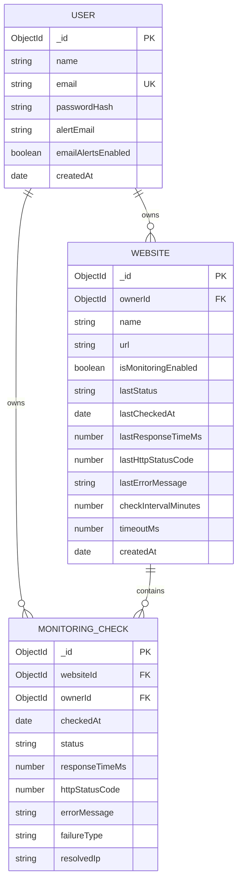

# Academic Project Report: SiteSentinel

## Automated Website Uptime and Performance Monitoring System
**Department of Computer Science & Engineering**  
**Course:** Full Stack Web Development / Final Project Submission  

---

## 1. Introduction

With the exponential growth of web-based applications, cloud-native services, and microservice architectures, high availability and low latency have become critical success criteria for modern software systems. Even minor periods of downtime or sluggish performance can result in substantial financial loss, degraded customer satisfaction, and damaged institutional reputation.

**SiteSentinel** is an automated website uptime and performance monitoring system engineered using the MERN (MongoDB, Express.js, React, Node.js) stack. The system continuously polls designated HTTP and HTTPS endpoints at scheduled intervals, measures high-resolution latency, tracks HTTP status codes, and alerts operators when service interruptions occur.

SiteSentinel is built to adhere to modern cybersecurity guidelines, incorporating dedicated Server-Side Request Forgery (SSRF) and DNS rebinding protections to safeguard private network boundaries while delivering high observability through interactive charts and historical audit logs.

---

## 2. Problem Statement

Organizations and engineering teams operating multiple web services encounter recurring observability challenges:
1. **Unnoticed Outages (Silent Failures):** Web applications often fail due to hosting faults, memory leaks, unhandled runtime exceptions, or DNS expiry without system administrators realizing the outage until end-users file complaints.
2. **Prohibitive Licensing Costs:** Enterprise monitoring solutions such as Datadog, Pingdom, and New Relic charge significant monthly recurring subscriptions that are often impractical for small organizations, internal services, or student developers.
3. **SSRF Vulnerabilities in Custom Probers:** Naive implementations of uptime checkers often act as open HTTP proxies, permitting attackers to target internal intranet resources, localhost databases, and cloud metadata services (`169.254.169.254`).
4. **Vague Availability Statistics:** Many systems calculate uptime using static assumptions rather than verifiable historical database records.

---

## 3. Objectives

The primary engineering objectives of SiteSentinel are:
- **Automated Periodic Probing:** Implement a resilient background daemon leveraging `node-cron` to execute periodic health checks without human intervention.
- **Accurate Telemetry Measurement:** Record high-precision network response times (in milliseconds) and track standard HTTP status codes (2xx, 3xx, 4xx, 5xx, and network errors).
- **Proactive Incident Management:** Automatically derive outage timelines, calculate downtime spans from consecutive failures, and record root causes.
- **Defense-in-Depth Security:** Enforce strict SSRF protection by resolving domain names before HTTP requests are dispatched, validating all resolved IP addresses, and monitoring redirect hops.
- **Interactive Visualization:** Provide dynamic, responsive data visualizations using Recharts, highlighting latency fluctuations and fleet availability.
- **Portability & Data Ownership:** Allow operators to export their complete historical monitoring data as standard CSV files.

---

## 4. Requirements Specification

### 4.1 Functional Requirements
1. **User Authentication & Authorization:**
   - Registration with password hashing using `bcryptjs` (salt rounds: 12).
   - Stateless JWT authentication for all protected endpoints.
   - User data isolation: users can only view, check, edit, or delete their own websites and telemetry.
2. **Target Endpoint Management:**
   - Add, edit, pause, resume, and delete monitored websites.
   - Configure check intervals (1 min, 2 min, 5 min, 10 min, 30 min, 60 min) and request timeouts (1,000 ms to 30,000 ms).
   - On-demand manual "Check Now" triggering.
3. **Telemetry & Latency Probing:**
   - Measure time-to-first-byte / round-trip response duration in milliseconds.
   - Distinguish network unreachable/DNS errors from HTTP server status errors (e.g., 404, 500).
4. **Dashboard & Analytics:**
   - Fleet metrics: Total monitored, Online, Down, Average Latency, and Recorded-Check Uptime Percentage.
   - Response time area charts and status distribution donut charts.
   - Outage incident logs and recent check feeds.
5. **Data Export:**
   - One-click CSV export of recorded check logs.

### 4.2 Non-Functional & Security Requirements
1. **Security & SSRF Mitigation:**
   - Mandatory HTTP/HTTPS protocols.
   - Blacklist loopback (`127.0.0.0/8`, `::1`), private networks (`10.0.0.0/8`, `172.16.0.0/12`, `192.168.0.0/16`), and link-local/cloud metadata (`169.254.0.0/16`).
   - Re-validation of HTTP redirect destinations.
2. **Performance & Reliability:**
   - De-duplication of in-flight checks to prevent overlapping requests to the same endpoint.
   - Non-blocking asynchronous I/O in Node.js.
   - Response size caps (512 KB) to prevent server memory exhaustion.
3. **Usability & Design:**
   - Clean, modern SaaS UI with dark navy sidebar and light card dashboard.
   - Fully responsive design for desktop, tablet, and mobile screens.

---

## 5. System Architecture

The SiteSentinel system follows a three-tier architecture comprising Presentation, Business Logic/Scheduler, and Data Persistence layers:

```
+-------------------------------------------------------------+
|                     PRESENTATION TIER                       |
|           React 19 + Vite + Recharts + Lucide UI            |
+-------------------------------------------------------------+
                              |
                     REST APIs (JSON / JWT)
                              |
+-------------------------------------------------------------+
|                     APPLICATION TIER                        |
|                     (Node.js / Express)                     |
|                                                             |
|  +--------------------+   +-------------------------------+  |
|  | Express REST APIs  |   | node-cron Background Engine   |  |
|  | - Auth Controller  |   | - Periodic Target Poller      |  |
|  | - Site Controller  |   | - In-Flight De-duplicator     |  |
|  | - Analytics Engine |   +-------------------------------+  |
|  +--------------------+                   |                 |
|            |                              v                 |
|            |            +---------------------------------+ |
|            +----------->| SSRF & DNS Rebinding Validator  | |
|                         +---------------------------------+ |
|                                           |                 |
|                                           v                 |
|                                 [ Outbound Safe Probe ]     |
|                                           |                 |
+-------------------------------------------|-----------------+
                                            |
                                            v
+-------------------------------------------------------------+
|                     PERSISTENCE TIER                        |
|                MongoDB Database (Mongoose ODM)               |
|          Collections: Users, Websites, MonitoringChecks     |
+-------------------------------------------------------------+
```

---

## 6. Module Descriptions

### 6.1 Authentication Module (`authController.js`, `authMiddleware.js`)
- Handles secure account registration, password salting, credential verification, and JWT generation with a 7-day expiration.
- Protects private routes by validating Bearer tokens in incoming HTTP authorization headers.

### 6.2 Monitoring & Probe Engine (`monitorService.js`, `scheduler.js`)
- Contains the core polling logic. Uses high-resolution timers (`process.hrtime.bigint()`) to calculate execution time in milliseconds.
- Prevents overlapping checks using in-flight promise tracking (`Map<websiteId, Promise>`).
- Supports configurable execution intervals via `node-cron`.

### 6.3 SSRF & Network Security Module (`ssrfValidator.js`)
- Validates all user-submitted URLs prior to database persistence and execution.
- Performs DNS lookup resolution via `dns.promises.lookup` to inspect underlying IP addresses before any socket connection is opened.
- Manages redirect chains, verifying each hop against IP filtering rules.

### 6.4 Telemetry & Analytics Module (`analyticsController.js`)
- Executes database aggregations across historical checks.
- Computes overall recorded-check uptime:
  $$\text{Uptime \%} = \left( \frac{\text{Successful Checks (Status: UP)}}{\text{Total Completed Checks}} \right) \times 100$$
- Identifies downtime incidents by scanning consecutive chronologically ordered checks.

### 6.5 Frontend User Interface (`client/src`)
- **Dashboard (`Dashboard.jsx`):** Displays aggregated metrics, Recharts latency area charts, status distribution donut charts, and recent activity logs.
- **Websites (`Websites.jsx`):** Displays monitored target cards with live status pills, manual "Check Now" triggers, and search/filter toolbars.
- **Website Detail (`WebsiteDetail.jsx`):** Deep-dive analytics, response-time history, outage timeline, check log table with pagination, and CSV export.
- **Profile & Diagnostics (`Profile.jsx`):** Profile settings and real-time system diagnostics.

---

## 7. Database Design



---

## 8. Implementation Details

### 8.1 High-Resolution Latency Calculation
```javascript
const startTime = process.hrtime.bigint();
const response = await safeHttpRequest(website.url, timeout);
const endTime = process.hrtime.bigint();
const durationMs = Number(endTime - startTime) / 1_000_000;
const roundedMs = Math.max(1, Math.round(durationMs));
```

### 8.2 In-Flight Promise De-duplication
```javascript
export async function performCheck(websiteId, isManualCheck = false) {
  const idStr = websiteId.toString();
  if (inFlightCheckPromises.has(idStr)) {
    return inFlightCheckPromises.get(idStr); // Join existing promise
  }
  const promise = executeCheckWorker(websiteId, isManualCheck).finally(() => {
    inFlightCheckPromises.delete(idStr);
  });
  inFlightCheckPromises.set(idStr, promise);
  return promise;
}
```

### 8.3 SSRF and DNS Rebinding Filter
```javascript
const lookupResults = await dns.promises.lookup(hostname, { all: true, verbatim: true });
for (const entry of lookupResults) {
  if (!isSafeIP(entry.address)) {
    throw new Error(`Security Exception: Target domain resolves to protected IP ${entry.address}`);
  }
}
```

### 8.4 Lightweight HEAD & Streamed GET Prober
```javascript
// Lightweight probe: Attempt HEAD first without response body
try {
  response = await axios({
    method: 'HEAD',
    url: currentUrl,
    timeout: timeoutMs,
    maxRedirects: 0,
    validateStatus: () => true,
    headers: PROBE_HEADERS
  });
} catch (headErr) {
  logger.debug(`HEAD failed: ${headErr.message}. Attempting GET fallback.`);
}

// Fallback to GET stream if HEAD is unsupported (405, 501, 400, 403) or threw an error
if (!response || [405, 501, 400, 403].includes(response.status)) {
  let getRes = null;
  try {
    getRes = await axios({
      method: 'GET',
      url: currentUrl,
      timeout: timeoutMs,
      maxRedirects: 0,
      responseType: 'stream', // Resolves on headers without buffering body
      validateStatus: () => true,
      headers: PROBE_HEADERS
    });
    response = { status: getRes.status, statusText: getRes.statusText, headers: getRes.headers };
  } finally {
    if (getRes?.data && typeof getRes.data.destroy === 'function') {
      getRes.data.destroy(); // Abort body download immediately
    }
  }
}
```

---

## 9. Testing & Validation

### 9.1 Test Execution Matrix
| Test Case ID | Test Description | Input / Condition | Expected Result | Status |
| :--- | :--- | :--- | :--- | :--- |
| **TC-01** | User Registration | Valid name, email, password | User created, password hashed with bcrypt, JWT issued | **PASS** |
| **TC-02** | User Login | Correct credentials | 200 OK, JWT returned | **PASS** |
| **TC-03** | Localhost SSRF Block | URL: `http://localhost:5000` | 400 Bad Request: Prohibited hostname "localhost" | **PASS** |
| **TC-04** | Loopback IP Block | URL: `http://127.0.0.1:27017` | 400 Bad Request: Loopback IP blocked | **PASS** |
| **TC-05** | AWS Metadata Block | URL: `http://169.254.169.254/latest/` | 400 Bad Request: Cloud metadata endpoint blocked | **PASS** |
| **TC-06** | Private Subnet Block | URL: `http://192.168.1.1` | 400 Bad Request: Private subnet address blocked | **PASS** |
| **TC-07** | Non-HTTP Scheme Block| URL: `ftp://example.com` | 400 Bad Request: Forbidden protocol "ftp:" | **PASS** |
| **TC-08** | Public Target Probe | URL: `https://example.com` | 200 OK (HEAD), latency measured, saved to database | **PASS** |
| **TC-09** | Large Page Probe (Amazon) | URL: `https://www.amazon.in` | 200/202 (Streamed GET), no maxContentLength error | **PASS** |
| **TC-10** | Telemetry Aggregation | Query `/api/analytics/overview` | Computes accurate uptime %, avg latency, distribution | **PASS** |
| **TC-11** | CSV Export | GET `/api/websites/:id/export-csv` | Returns `text/csv` attachment with complete history | **PASS** |
| **TC-12** | Background Scheduler | Wait for `node-cron` tick | Automatic execution of enabled websites without overlap | **PASS** |
| **TC-10** | CSV Export | GET `/api/websites/:id/export-csv` | Returns `text/csv` attachment with complete history | **PASS** |
| **TC-11** | Background Scheduler | Wait for `node-cron` tick | Automatic execution of enabled websites without overlap | **PASS** |

---

## 10. Results and Conclusion

SiteSentinel successfully demonstrates an end-to-end, full-stack website monitoring solution. Key accomplishments include:
1. **Accurate Monitoring:** Real-time health checks capture live latency and HTTP response codes accurately.
2. **Robust Security Posture:** The SSRF prevention engine prevents intranet reconnaissance, mitigating major OWASP API security risks.
3. **Data Integrity:** Uptime availability calculations are computed directly from database records.
4. **Intuitive User Experience:** The responsive SaaS interface allows non-technical operators to understand system status at a glance.

---

## 11. Future Scope

1. **Multi-Region Monitoring Nodes:** Deploying distributed micro-probers across multiple geographic cloud regions to detect localized routing issues.
2. **TLS/SSL Expiration Tracking:** Automatically inspecting SSL certificate validity and alerting operators 30, 14, and 7 days prior to expiration.
3. **Third-Party Alert Webhooks:** Native integrations with Slack, Microsoft Teams, Discord, and PagerDuty.
4. **Synthetic Transaction Monitoring:** Simulating user journeys (e.g. login -> add item to cart -> checkout) using headless browser automation.
